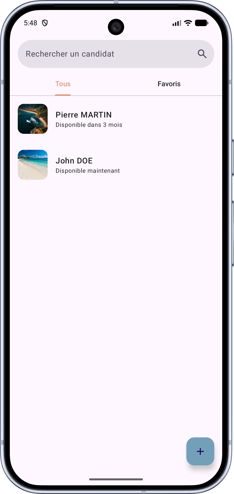
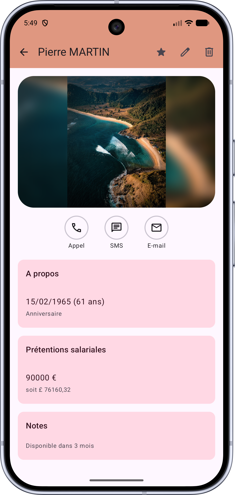
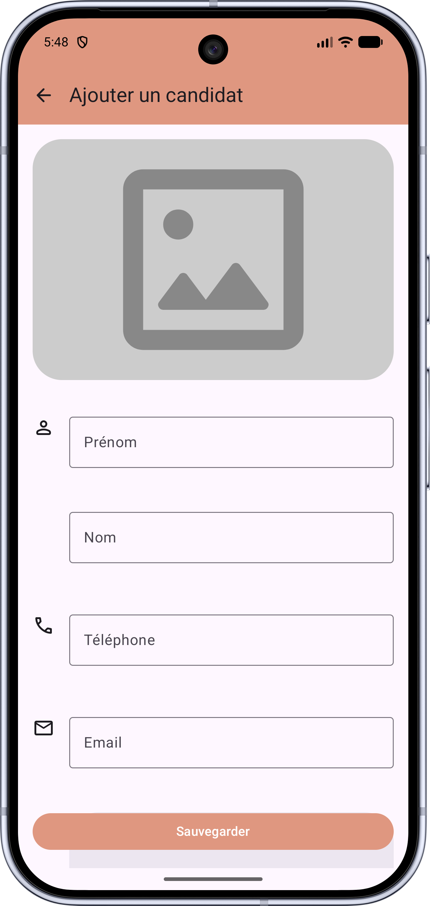
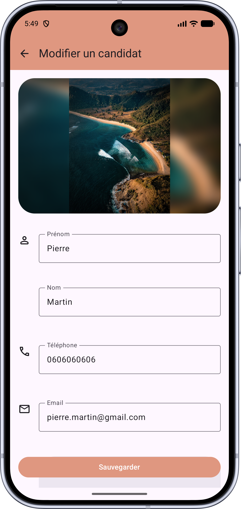

# 🚘 Vitesse App

Android application developed with **Kotlin** and **Jetpack Compose** focused on Clean Architecture, maintainability, and modern Android best practices.

## Overview
Vitesse was developed as part of an OpenClassrooms certification project (simulated scenario for an automotive company's HR department).
It optimizes candidate management, enabling HR professionals to create, update, manage favorites, and track salary conversions seamlessly.

The primary objectives of this project were:
- Applying a clear and scalable Clean Architecture with an MVVM pattern.   
- Implementing offline-first local data persistence using Room and remote API integration with Retrofit.   
- Managing reactive UI state and data flows using Kotlin Coroutines and Flow.
- Incorporating Google's modern Photo Picker for image handling.
- Supporting internationalization with full English and French localization.
- Ensuring high code quality and reliability through unit and instrumentation tests.

## Features
- **Candidate Management**: Full CRUD operations (create, update, delete) for HR candidates.
- **Favorites Persistence**: Bookmark candidates with instant state reflection using Room.
- **Live Salary Conversion**: Dynamic calculation converting EUR salaries to GBP via a REST exchange rate API upon profile display.
- **Media Selection**: Candidate profile picture upload powered by the native Android Photo Picker.
- **Multi-Language Support**: Complete localization in both English and French.
- **Testing**: Unit and instrumentation test suite verifying app behavior and data validation.
- **Dark Mode Support**: Full support for light and dark themes using Material 3 theming.

## Technologies & Libraries
- Language: Kotlin
- UI: Jetpack Compose, Material 3, Navigation Compose, 
- Architecture: Clean Architecture, MVVM
- Presentation Layer: ViewModel, StateFlow / Flow
- Data Layer: Room (SQL local database), Retrofit (REST API)
- Dependency Injection: Hilt
- Testing: JUnit4, MockK, Turbine
- Asynchronicity: Coroutines

## Screenshots
| Home Screen | Details Screen | Add a candidate | Edit a candidate
|:---:|:---:|:---:|:---:|
|  |  |  | 
